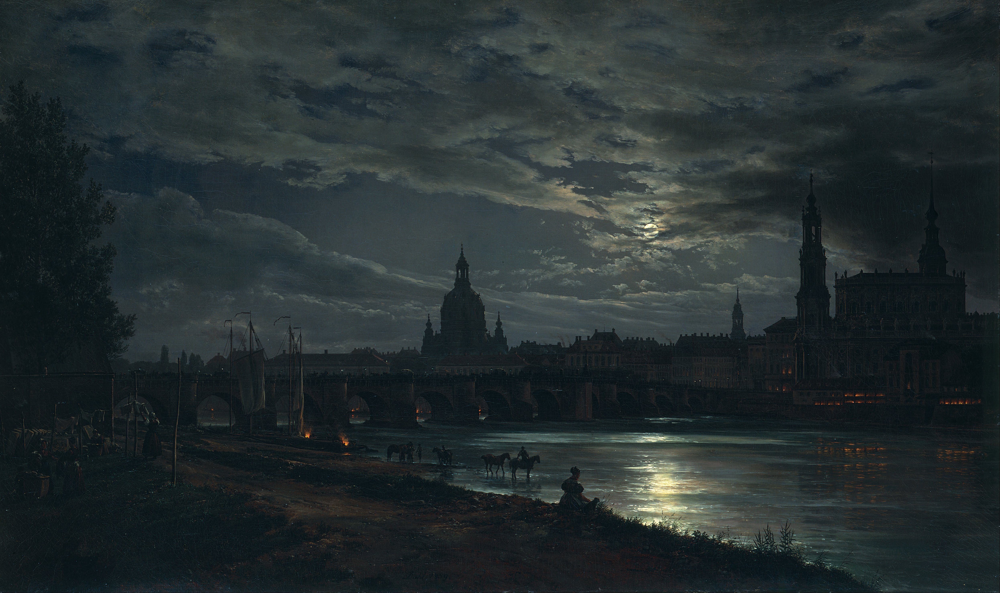

# Dresden by Moonlight for Omarchy

An [Omarchy](https://omarchy.org/) theme built around Johan Christian Dahl's *View of Dresden by Moonlight*. Slate surfaces and mint accents complement the painting's night sky, while a warm window-border highlight echoes its moonlight.



The repository root is the theme directory:

```text
colors.toml                         Omarchy color palette
icons.theme                         Yaru-sage icon variant
backgrounds/dresden-by-moonlight.jpg Wallpaper
```

Omarchy generates its supported app themes from `colors.toml`.

## Install from GitHub

Publish this directory as a public GitHub repository named `omarchy-dresden-by-moonlight-theme`, then run:

```sh
omarchy theme install https://github.com/mbsolvr/omarchy-dresden-by-moonlight-theme.git
```

Omarchy clones the repository and applies it. With this repository name, the installed theme name is `dresden-by-moonlight`.

Omarchy replaces an existing theme directory with the same name during installation. Save any local edits there before installing from GitHub.

## Install from a local checkout

Run these commands from this repository's root directory:

```sh
theme_dir="$HOME/.config/omarchy/themes/dresden-by-moonlight"
mkdir -p "$theme_dir/backgrounds"
cp colors.toml icons.theme "$theme_dir/"
cp backgrounds/dresden-by-moonlight.jpg "$theme_dir/backgrounds/"
omarchy theme set dresden-by-moonlight
```

Repeat these commands after changing the files in your local checkout. To select the installed theme again later, run `omarchy theme set dresden-by-moonlight`.

## Update a GitHub installation

```sh
git -C "$HOME/.config/omarchy/themes/dresden-by-moonlight" pull --ff-only
omarchy theme set dresden-by-moonlight
```

The first command retrieves changes; the second applies the updated palette. Omarchy also offers `omarchy theme update` to update all Git-installed themes.

## Credits

- Painting and wallpaper: Johan Christian Dahl, *View of Dresden by Moonlight*. The image comes from [Wikimedia Commons](https://commons.wikimedia.org/wiki/File:Johan_Christian_Dahl_-_View_of_Dresden_by_Moonlight_-_Google_Art_Project.jpg), which marks this reproduction as public domain. The wallpaper retains the original 4,984 × 2,957 resolution.
